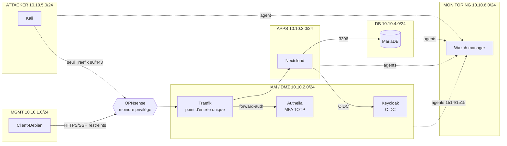

# Zero Trust Lab

> **Idée centrale** : ne pas se contenter de déployer des briques Zero Trust, mais **prouver** leur efficacité. Une chaîne d'attaque réelle (scan → force brute → exfiltration) réussit contre un réseau plat (Phase A), puis est rejouée contre la même infrastructure reconstruite en Zero Trust (Phase B).

## Architecture (Phase B)

| Segment | Sous-réseau | Machine (IP) | Rôle |
|---|---|---|---|
| MGMT | 10.10.1.0/24 | Client-Debian (10.10.1.50) | Administration |
| IAM / DMZ | 10.10.2.0/24 | Server-IAM (10.10.2.10) | Keycloak, Authelia, Traefik |
| APPS | 10.10.3.0/24 | Server-Nextcloud (10.10.3.30) | Application |
| DB | 10.10.4.0/24 | Server-DB (10.10.4.20) | MariaDB |
| ATTACKER | 10.10.5.0/24 | Kali (10.10.5.50) | Poste d'attaque |
| MONITORING | 10.10.6.0/24 | Server-Monitoring (10.10.6.10) | Wazuh |

**Phase A — baseline** : un seul sous-réseau `192.168.1.0/24`, aucun filtrage (OPNsense, MariaDB, Nextcloud, Kali).

Détails : [architecture](zero-trust-lab/docs/architecture.md).

## Points forts techniques

- **Double authentification en chaîne** : Authelia (mot de passe + TOTP, politique `deny` par défaut) devant Traefik, puis SSO Keycloak (OIDC) vers Nextcloud.
- **Segmentation en 6 zones** avec politique de moindre privilège sur **toutes** les interfaces OPNsense, vérifiée par des tests **positifs et négatifs**.
- **Supervision unidirectionnelle** : les agents Wazuh se connectent vers le manager ; le segment MONITORING n'a aucune règle sortante.
- **Durcissement documenté** : port 8080 retiré, pas de socket Docker pour Traefik, URI de redirection exactes, secrets régénérés, compte admin permanent.
- **Honnêteté sur les limites** : voir [limites connues](zero-trust-lab/docs/limits.md).

### Trois tests qui ont trouvé de vraies failles

1. **Règle `any→any` oubliée (MONITORING)** : le test d'isolation a révélé une règle non documentée et non journalisée qui laissait MONITORING joindre IAM et APPS en SSH. Désactivée, testée, supprimée ([T4](zero-trust-lab/docs/tests.md)).
2. **Contournement d'Authelia depuis ATTACKER** : le rejeu de la Phase A a montré que Kali atteignait Nextcloud directement, à cause de deux règles « Internet » trop larges sur OPT4. Corrigé par un alias `RFC1918` inversé ; re-test : tout `filtered` hors Traefik, Hydra bloqué dès la connexion ([T10-T13](zero-trust-lab/docs/tests.md)).
3. **Un bastion d'administration qui n'en était pas un (MGMT)** : l'audit complet des règles, mené sur **toutes** les interfaces après la découverte précédente, a révélé que le segment MGMT — présenté comme le point de confiance le plus élevé du lab — pouvait en réalité ouvrir une session SSH directe vers n'importe quel serveur, contournant entièrement Authelia. Restreint à un périmètre explicite de 4 hôtes administrés ([T14](zero-trust-lab/docs/tests.md)).

## Démarche

1. **Step 1-4** — Phase A : réseau plat, Server-DB, Server-Nextcloud et chaîne d'attaque de référence (Nmap → CUPP → Hydra SSH → extraction d'identifiants → accès DB → interception HTTP).
2. **Step 5-6** — Segmentation en six segments OPNsense et règles de moindre privilège.
3. **Step 7-9** ✅ — IAM : Keycloak, Traefik, Authelia MFA, SSO OIDC vers Nextcloud.
4. **Step 10** ✅ — Wazuh 4.14.9, 4 agents, flux unidirectionnel ([docs/wazuh.md](zero-trust-lab/docs/wazuh.md)).
5. **Step 11** ✅ — Durcissement (TOTP, ports, secrets, admin permanent).
6. **Step 12** ✅ — Rejeu complet de la chaîne d'attaque depuis Kali, faille trouvée et corrigée ([tests T10-T13](zero-trust-lab/docs/tests.md)).
7. **Step 13** ✅ — Validation finale : audit complet des règles pare-feu sur toutes les interfaces, moindre privilège appliqué partout ([T14](zero-trust-lab/docs/tests.md)).

## Résultats : avant / après

| Attaque | Phase A (plat) | Phase B (Zero Trust) |
|---|---|---|
| Scan réseau | ❌ Tous services visibles | ✅ Seul Traefik 80/443 visible ; le reste `filtered` |
| Force brute SSH | ❌ Mot de passe trouvé en 2 min | ✅ Échec immédiat : connexion impossible, Hydra rejoué et bloqué |
| Extraction de configuration | ❌ Identifiants en clair | ✅ Prérequis (accès SSH) bloqué |
| Accès direct base de données | ❌ DB non filtrée | ✅ 3306 : timeout |
| Mouvement latéral | ❌ Pas de segmentation | ✅ MGMT, APPS, MONITORING : timeout |
| Interception de trafic | ❌ Pas de TLS | ✅ Seul chemin : Traefik/TLS ; accès par IP : `404` |

Au-delà du rejeu de la Phase A, un audit complet des règles pare-feu a trouvé et corrigé trois failles distinctes sur trois interfaces différentes — chacune testée, corrigée, puis vérifiée par un test de non-régression avant de passer à la suivante. Détail complet, sorties brutes et corrections : [tests](zero-trust-lab/docs/tests.md).

## Documentation

- [Architecture](zero-trust-lab/docs/architecture.md)
- [Tests de validation](zero-trust-lab/docs/tests.md)
- [Déploiement Wazuh](zero-trust-lab/docs/wazuh.md)
- [Limites connues](zero-trust-lab/docs/limits.md)
- [Guide de publication](zero-trust-lab/GIT-SETUP.md)

## Stack

OPNsense · VirtualBox · Debian 13 · MariaDB · Nextcloud · Keycloak 26 · Traefik 3.3 · Authelia 4.38 · Wazuh 4.14.9 · Kali Linux · Nmap · Hydra · CUPP · Wireshark

## Avertissement sur les identifiants

Le lab tourne dans des réseaux privés non routables. Aucun secret d'infrastructure n'est publié (placeholders, voir `.env.example`) ; les mots de passe volontairement faibles des comptes de test sont conservés car ils sont au cœur de la démonstration de la force brute.

## Auteure

Imane Arrach
