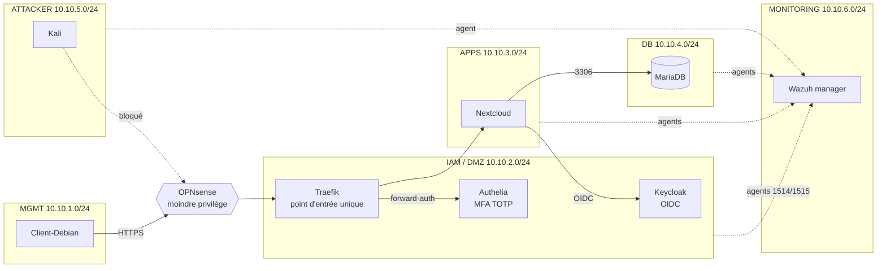

# Zero Trust Lab

> **Idée centrale** : ne pas se contenter de déployer des briques Zero Trust, mais **prouver** leur efficacité. Une chaîne d'attaque réelle (scan → force brute → exfiltration) réussit contre un réseau plat (Phase A), puis est rejouée contre la même infrastructure reconstruite en Zero Trust (Phase B).

Projet réalisé dans le cadre du module Cloud Computing et Sécurité, FST Marrakech, filière SIT.

## Architecture (Phase B)

| Segment | Sous-réseau | Machine (IP) | Rôle |
|---|---|---|---|
| MGMT | 10.10.1.0/24 | Client-Debian (10.10.1.50) | Administration |
| IAM / DMZ | 10.10.2.0/24 | Server-IAM (10.10.2.10) | Keycloak, Authelia, Traefik |
| APPS | 10.10.3.0/24 | Server-Nextcloud (10.10.3.30) | Application |
| DB | 10.10.4.0/24 | Server-DB (10.10.4.20) | MariaDB |
| ATTACKER | 10.10.5.0/24 | Kali (10.10.5.50) | Poste d'attaque |
| MONITORING | 10.10.6.0/24 | Server-Monitoring (10.10.6.10) | Wazuh |

**Phase A — baseline** : un seul sous-réseau `192.168.1.0/24`, aucun filtrage (OPNsense, MariaDB, Nextcloud, Kali).

Détails : [architecture](zero-trust-lab/docs/architecture.md).

## Points forts techniques

- **Double authentification en chaîne** : Authelia (mot de passe + TOTP, politique `deny` par défaut) devant Traefik, puis SSO Keycloak (OIDC) vers Nextcloud.
- **Segmentation en 6 zones** avec politique de moindre privilège sur OPNsense, vérifiée par des tests **positifs et négatifs**.
- **Supervision unidirectionnelle** : les agents Wazuh se connectent vers le manager ; le segment MONITORING n'a aucune règle sortante.
- **Durcissement documenté** : port 8080 retiré, pas de socket Docker pour Traefik, URI de redirection exactes, secrets régénérés, compte admin permanent.
- **Honnêteté sur les limites** : voir [limites connues](zero-trust-lab/docs/limits.md).

### Un test négatif qui a trouvé une vraie faille

Le test d'isolation depuis MONITORING a révélé une règle `any→any` oubliée et non journalisée sur OPT5, qui laissait MONITORING joindre IAM et APPS en SSH. Elle a été désactivée, testée, puis supprimée ([voir T4](zero-trust-lab/docs/tests.md)).

## Démarche

1. **Step 1-4** — Phase A : réseau plat, Server-DB, Server-Nextcloud et chaîne d'attaque de référence (Nmap → CUPP → Hydra SSH → extraction d'identifiants → accès DB → interception HTTP).
2. **Step 5-6** — Segmentation en six segments OPNsense et règles de moindre privilège.
3. **Step 7-9** ✅ — IAM : Keycloak, Traefik, Authelia MFA, SSO OIDC vers Nextcloud.
4. **Step 10** ✅ — Wazuh 4.14.9, 4 agents, flux unidirectionnel ([docs/wazuh.md](zero-trust-lab/docs/wazuh.md)).
5. **Step 11** ✅ — Durcissement (TOTP, ports, secrets, admin permanent).
6. **Step 12** *(en cours)* — Rejeu de la chaîne d'attaque depuis Kali contre la Phase B.
7. **Validation finale** *(à venir)* — Audit des règles, checklist de reproductibilité.

## Résultats : avant / après

| Attaque | Phase A (plat) | Phase B (Zero Trust) |
|---|---|---|
| Scan réseau | ❌ Réussi — tous services visibles | *Step 12* |
| Force brute SSH | ❌ Réussi en 2 min (mot de passe faible) | *Step 12* |
| Extraction de configuration | ❌ Réussi — identifiants en clair | *Step 12* |
| Accès direct base de données | ❌ Réussi — DB non filtrée | *Step 12* |
| Mouvement latéral | ❌ Réussi — pas de segmentation | *Step 12* |
| Interception de trafic | ❌ Réussi — pas de TLS | *Step 12* |

Preuves déjà obtenues en Phase B : port 8080 inaccessible, accès par IP rejeté (HTTP 400), MONITORING sans flux sortant ([tests](zero-trust-lab/docs/tests.md)).

## Documentation

- [Architecture](zero-trust-lab/docs/architecture.md)
- [Tests de validation](zero-trust-lab/docs/tests.md)
- [Déploiement Wazuh](zero-trust-lab/docs/wazuh.md)
- [Limites connues](zero-trust-lab/docs/limits.md)
- [Guide de publication](zero-trust-lab/GIT-SETUP.md)

## Stack

OPNsense · VirtualBox · Debian 13 · MariaDB · Nextcloud · Keycloak 26 · Traefik 3.3 · Authelia 4.38 · Wazuh 4.14.9 · Kali Linux · Nmap · Hydra · CUPP · Wireshark

## Avertissement sur les identifiants

Le lab tourne dans des réseaux privés non routables. Aucun secret d'infrastructure n'est publié (placeholders, voir `.env.example`) ; les mots de passe volontairement faibles des comptes de test sont conservés car ils sont au cœur de la démonstration de la force brute.

## Auteure

Imane Arrach
