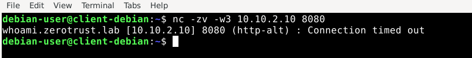
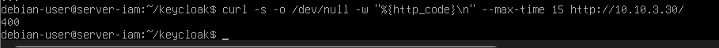
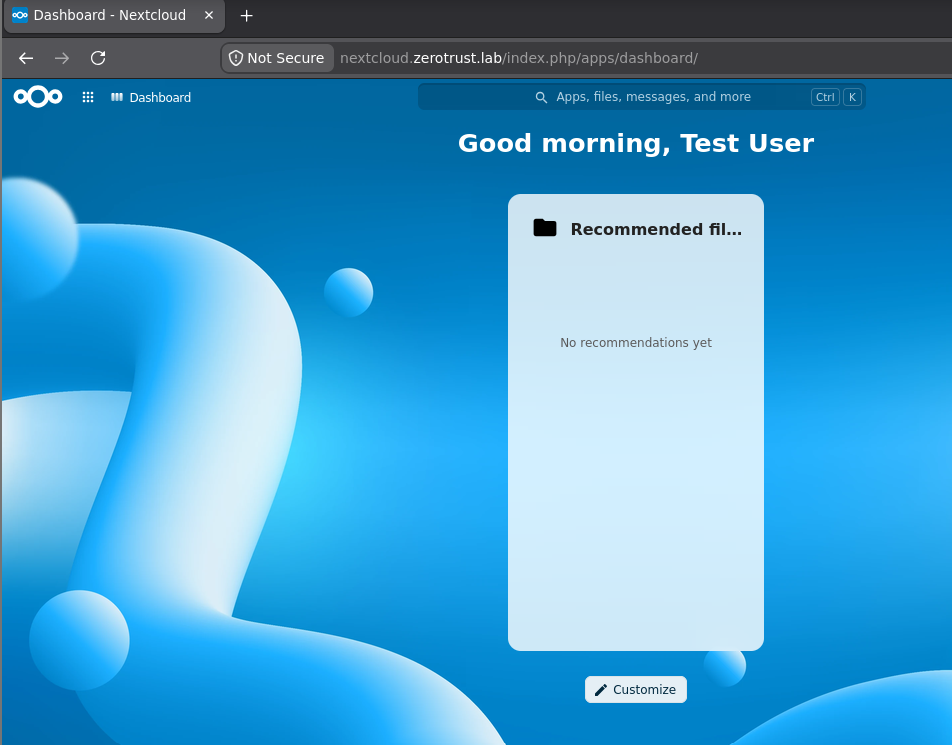
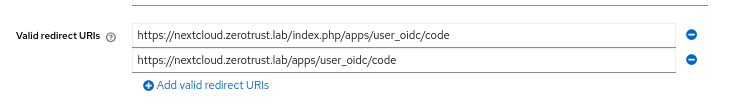

# Tests de validation

Chaque test suit le même format : **action → résultat attendu → résultat observé → interprétation**. Les sorties ci-dessous sont celles relevées dans le lab.

## 1. Segmentation et isolation

### T1 — Le port 8080 de Keycloak n'est plus joignable

Depuis Client-Debian (MGMT). Le port d'administration directe a été retiré du compose : Traefik est l'unique point d'entrée.

```console
debian-user@client-debian:~$ nc -zv -w3 10.10.2.10 8080
whoami.zerotrust.lab [10.10.2.10] 8080 (http-alt) : Connection timed out
```



**Interprétation** : `timed out` (et non `refused`) indique que le paquet est abandonné par le pare-feu, sans réponse.

### T2 — Nextcloud refuse l'accès par adresse IP (depuis IAM)

Depuis Server-IAM, requête vers Nextcloud par son IP puis avec le nom de domaine :

```console
$ curl -s -o /dev/null -w "%{http_code}\n" --max-time 15 http://10.10.3.30/
400
$ curl -s -o /dev/null -w "%{http_code}\n" --max-time 15 -H "Host: nextcloud.zerotrust.lab" http://10.10.3.30/
302
```




**Interprétation** : l'accès par IP est rejeté (`400`, domaine non fiable). **Ce test ne prouve rien à lui seul** : il est valable depuis IAM, qui est le chemin légitime. Le test T10 montre que ce n'était pas suffisant depuis le segment ATTACKER.

### T3 — Flux Traefik → Nextcloud

```console
$ nc -zv -w4 10.10.3.30 80
(UNKNOWN) [10.10.3.30] 80 (http) open
$ nc -zv -w4 10.10.3.30 443
(UNKNOWN) [10.10.3.30] 443 (https) : Connection refused
```

**Interprétation** : seul HTTP/80 est exposé par Nextcloud vers IAM ; le TLS est terminé par Traefik.

### T4 — Isolation du segment MONITORING (test négatif)

Depuis Server-Monitoring, connexions sortantes vers IAM et APPS (SSH, TCP) : **toutes expirent**. Le flux Wazuh est strictement unidirectionnel (agents → manager).

**Incident révélé par ce test** : une règle `any→any` TCP non documentée et non journalisée sur OPT5 permettait à MONITORING d'atteindre IAM/APPS en SSH. Désactivée, testée (tous les tests sortants expirent), puis supprimée.

**Leçon** : un audit visuel des règles ne remplace pas un test négatif exécuté.

## 2. Authentification

| Test | Action | Attendu | Observé |
|---|---|---|---|
| T5 Sans session | `curl -I https://whoami.zerotrust.lab` | Redirection vers Authelia | `302` vers `auth.zerotrust.lab` ; `401` visibles dans les logs Traefik côté forward-auth |
| T6 MFA | Connexion Authelia | Mot de passe puis TOTP exigés | Code à usage unique demandé après le mot de passe |
| T7 Chaîne SSO | Accès à Nextcloud après Authelia | Redirection Keycloak puis tableau de bord | Tableau de bord Nextcloud affiché (utilisateur `Test User`) |
| T8 URI de redirection | Redirect URI non enregistrée | Rejet Keycloak | `Invalid parameter: redirect_uri` |




## 3. Supervision

| Test | Attendu | Observé |
|---|---|---|
| T9 Agents Wazuh | 4 agents enregistrés | 001 server-iam, 002 server-nextcloud, 003 server-db, 004 kali-attacker |


*(server-iam et kali-attacker actifs au moment de la capture ; server-nextcloud et server-db déconnectés car leurs VM étaient éteintes — cela ne remet pas en cause l'enregistrement des 4 agents.)*

## 4. Rejeu de la Phase A depuis Kali (Step 12)

### T10 — Faille trouvée au rejeu, puis corrigée : contournement d'Authelia depuis ATTACKER

**Premier scan (avant correction)** depuis Kali (10.10.5.50) :

```console
$ nmap -sV -Pn --top-ports 1000 --max-retries 1 -oN a1-scan.txt 10.10.2.10 10.10.3.30 10.10.4.20
10.10.2.10  : 80/tcp open, 443/tcp open (Traefik)
10.10.3.30  : 80/tcp open  http  Apache httpd 2.4.68 (Debian) ; 443/tcp closed
10.10.4.20  : 80/tcp closed, 443/tcp closed
```

- Nextcloud (APPS) était joignable directement sur le port 80, **sans passer par Traefik ni Authelia**.
- La DB répondait `closed` (et non `filtered`) : les paquets traversaient le pare-feu.

Impact mesuré depuis Kali :

```console
$ curl -4 -m8 -s -H "Host: nextcloud.zerotrust.lab" http://10.10.3.30/status.php
{"installed":true,"maintenance":false,"needsDbUpgrade":false,"version":"35.0.1.1","versionstring":"35.0.1", ...}
$ curl -4 -m8 -s -o /dev/null -w "%{http_code}\n" -H "Host: nextcloud.zerotrust.lab" http://10.10.3.30/index.php/login
200
```

- Fuite de la version exacte de Nextcloud, sans authentification.
- Page de connexion servie directement : la couche Authelia (MFA) était contournée depuis ce segment. Keycloak restait une seconde barrière.
- Gravité : **moyenne**.

**Cause racine** : deux règles d'OPT4, `Attacker -> Internet http` et `https`, avaient pour destination `*`. Prévues pour l'accès Internet, elles couvraient aussi tous les segments internes.

**Correction** (OPNsense, OPT4) :

1. Alias `RFC1918` (`10.0.0.0/8`, `172.16.0.0/12`, `192.168.0.0/16`).
2. Nouvelle règle, placée en premier : `OPT4 network` → `10.10.2.10`, ports 80/443 (Traefik uniquement).
3. Les deux règles « Internet » passent en destination inversée (`!RFC1918`) : Internet oui, réseaux privés non.

**Après correction** :

```console
$ curl -4 -m8 -s -o /dev/null -w "%{http_code}\n" -H "Host: nextcloud.zerotrust.lab" http://10.10.3.30/status.php
000
$ nmap -sV -Pn --max-retries 1 -oN a1-scan-apres.txt 10.10.2.10 10.10.3.30 10.10.4.20
10.10.2.10 : 80/tcp open, 443/tcp open
10.10.3.30 : 1000 ports filtered
10.10.4.20 : 1000 ports filtered
```

Non-régression : accès Internet de Kali conservé (`HTTP/2 200` sur un site public) ; Client-Debian atteint toujours Nextcloud par Authelia puis Keycloak.

**Leçon** : un test fait depuis le chemin légitime (T2, depuis IAM) ne prouve pas l'absence de chemin illicite. Seul le rejeu depuis le segment ATTACKER l'a révélé.

### T11 — Services internes depuis ATTACKER (après correction)

```console
$ nc -zv -w3 10.10.3.30 22   -> Connection timed out
$ nc -zv -w3 10.10.4.20 3306 -> Connection timed out
$ nc -zv -w3 10.10.1.50 22   -> Connection timed out
$ nc -zv -w3 10.10.6.10 22   -> Connection timed out
```

**Interprétation** : SSH vers APPS, base de données, poste d'administration et supervision sont tous inaccessibles depuis ATTACKER.

### T12 — Seul chemin autorisé vers Traefik, sans contenu applicatif

```console
$ curl -4 -kI https://10.10.2.10
HTTP/2 404
content-type: text/plain; charset=utf-8
```

**Interprétation** : accédé par IP, Traefik ne trouve aucune route (`404`) et ne sert aucun contenu applicatif. Les services ne sont joignables que par leur nom de domaine, derrière Authelia.

### T13 — Force brute SSH rejouée (Hydra) : échec immédiat

En Phase A (réseau plat, Step 4), la même attaque avait réussi en moins de 2 minutes contre le compte de test `nextcloud-user`. Rejouée depuis Kali contre la Phase B, après la correction du T10 :

```console
$ hydra -l nextcloud-user -P imane_fast.txt -t 4 -f ssh://10.10.3.30
Hydra v9.6 (c) 2023 by van Hauser/THC & David Maciejak
[DATA] max 4 tasks per 1 server, overall 4 tasks, 22 login tries (l:1/p:22), ~6 tries per task
[DATA] attacking ssh://10.10.3.30:22/
[ERROR] could not connect to ssh://10.10.3.30:22 - Timeout connecting to 10.10.3.30
```

**Interprétation** : Hydra échoue dès l'étape de connexion, avant même de tester le premier mot de passe de la liste. Le port SSH étant inaccessible depuis ATTACKER (T11), l'attaque ne peut pas même démarrer — contrairement à la Phase A, où le mot de passe faible était trouvé en 2 minutes.

## 5. Validation finale : audit complet des règles OPNsense (Step 13)

### T14 — Moindre privilège sur toutes les interfaces

Le rejeu de la Phase A (T10) a révélé une règle trop large sur une seule interface (OPT4). Plutôt que de considérer le problème résolu, un audit a été mené sur **toutes** les interfaces du pare-feu, pour vérifier qu'aucune autre règle n'avait le même défaut (destination `*` trop permissive).

**Résultat de l'audit** :

| Interface | État avant audit | Action |
|---|---|---|
| LAN (MGMT) | 2 règles `MGMT -> Any SSH/HTTPS (admin)`, destination `*` : Client-Debian pouvait atteindre **n'importe quelle machine** en SSH/HTTPS, y compris en contournant Authelia | Corrigé |
| OPT1 (IAM) | Règles « Web/Web S », destination `*` : portée Internet non restreinte | Corrigé |
| OPT2 (APPS) | Règles « Internet HTTP/HTTPS », destination `*` : même défaut | Corrigé |
| OPT3 (DB) | Aucune règle sortante superflue | Conforme, rien changé |
| OPT4 (ATTACKER) | Déjà corrigé au T10 | — |
| OPT5 (MONITORING) | Aucune règle définie | Conforme, rien changé |
| WAN | Aucune règle définie | Conforme (lab non exposé) |

**Le plus significatif : MGMT.** Le segment présenté comme le point de confiance le plus élevé du lab avait en réalité le moins de restrictions : une règle `destination *` laissait Client-Debian ouvrir une session SSH directe vers Nextcloud, la base de données ou Monitoring, **sans jamais passer par Traefik ni Authelia**. Un vrai modèle bastion authentifie et journalise chaque session individuellement ; une règle réseau large héritée du Step 6 n'en est pas un.

**Correction appliquée, même méthode partout** : un alias des cibles légitimes (`HOTES_ADMINISTRES` pour MGMT : les 4 serveurs administrés) ou des exceptions de flux internes nécessaires (IAM → APPS sur le port 80 pour le reverse proxy ; APPS → IAM sur le port 443 pour la validation OIDC côté serveur), placées **avant** une règle Internet inversée sur l'alias `RFC1918` (accès web externe autorisé, réseaux privés refusés).

**Tests de non-régression, après chaque correction** :

```console
# MGMT : administration préservée, périmètre restreint
ssh nextcloud-user@10.10.3.30          -> connexion réussie (dans l'alias)
nc -zv -w3 10.10.5.50 22               -> timeout (Kali, hors alias)
curl -4 -m8 -sI https://nextcloud.zerotrust.lab  -> 302 vers Authelia (Traefik, dans l'alias)
curl -4 -m8 -sI https://www.wikipedia.org        -> HTTP/2 200 (Internet préservé)

# OPT1/OPT2 : SSO complet rejoué de bout en bout après correction
# Authelia -> Keycloak (test.user) -> tableau de bord Nextcloud : succès
nc -zv -w3 10.10.3.30 80                -> open (proxy Traefik -> Nextcloud préservé)
curl -4 -m8 -sI http://example.com       -> 200 OK (Internet depuis IAM et APPS préservé)
nc -zv -w3 10.10.4.20 80 (depuis IAM)    -> timeout (DB hors périmètre IAM)
nc -zv -w3 10.10.1.50 80 (depuis APPS)   -> timeout (MGMT hors périmètre APPS)
```

**Deux fausses alertes rencontrées pendant l'audit, documentées pour la méthode** : un premier test MGMT a semblé échouer (timeout vers Nextcloud) — cause réelle : Server-DB et Server-IAM étaient simplement éteints, pas une erreur de règle. Un test Internet depuis APPS a aussi semblé échouer sur un nom de domaine précis (`neverssl.com`, code 28) alors qu'une IP publique directe (`1.1.1.1`) répondait sans problème — un deuxième essai a confirmé que c'était transitoire (DNS), pas une régression. **Leçon** : vérifier l'état des VMs et reproduire un test ambigu avant de conclure à une faille.

### T15 — Défense en profondeur Apache (`Require ip`) : vérifiée en recréant la faille du T10

L'amélioration notée en T10 — restreindre Apache sur Server-Nextcloud aux seules requêtes venant de Traefik — a été appliquée :

```apache
# /etc/apache2/sites-available/nextcloud.conf
<Directory /var/www/nextcloud>
    Require ip 10.10.2.10
    AllowOverride All
    Options FollowSymLinks MultiViews
</Directory>
```

En fonctionnement normal, cette règle est redondante avec le pare-feu : seul `10.10.2.10` (Server-IAM) peut déjà atteindre Apache sur le port 80, puisque c'est le seul hôte du segment IAM/DMZ. Son vrai rôle est de **rattraper exactement le type d'erreur trouvé au T10** : une règle pare-feu mal configurée qui laisserait passer un autre segment.

**Pour le vérifier, la faille du T10 a été recréée volontairement et brièvement** : une règle temporaire sur OPT4 (`ATTACKER network -> 10.10.3.30:80`, supprimée immédiatement après le test) a réouvert exactement le chemin réseau exploité en Phase A/T10.

```console
# Depuis Kali, avec le trou pare-feu temporairement rouvert :
$ curl -4 -m8 -s -o /dev/null -w "%{http_code}\n" -H "Host: nextcloud.zerotrust.lab" http://10.10.3.30/status.php
404
```

Le journal Apache confirme que le refus vient bien de la restriction applicative, pas d'une coïncidence réseau :

```console
$ sudo tail /var/log/apache2/error.log
[authz_core:error] [client 10.10.5.50:40256] AH01630: client denied by server configuration: /var/www/nextcloud/status.php
```

`AH01630: client denied by server configuration` est le message exact qu'Apache génère pour un refus `Require ip`. Le `404` (plutôt qu'un `403` explicite) vient d'une page d'erreur personnalisée qui masque même l'existence de la ressource — une fuite d'information en moins que la réponse standard.

**Après suppression de la règle temporaire**, retour immédiat au comportement normal :

```console
$ curl -4 -m8 -s -o /dev/null -w "%{http_code}\n" -H "Host: nextcloud.zerotrust.lab" http://10.10.3.30/status.php
000
```

**Interprétation** : contrairement au T10, où la même requête renvoyait du contenu applicatif (`200`, version Nextcloud en clair), une règle pare-feu identique mal configurée serait maintenant rattrapée par Apache lui-même. La défense en profondeur ne repose plus sur une hypothèse : elle a été testée dans les conditions exactes de la faille originale.

## 6. Bilan avant / après

| Attaque | Phase A (réseau plat) | Phase B (Zero Trust) |
|---|---|---|
| Scan Nmap | Tous services visibles | Un seul point d'entrée visible (Traefik 80/443) ; le reste `filtered` (T10) |
| Force brute SSH | Succès en 2 min | Échec immédiat, connexion impossible (T11, T13) |
| Extraction de configuration | Succès | Impossible : prérequis (accès SSH) bloqué |
| Accès direct DB | Succès | Timeout sur 3306 (T11) |
| Mouvement latéral | Succès | Timeout vers MGMT, APPS, MONITORING (T11) |
| Interception HTTP | Succès | Seul chemin : Traefik/TLS, accès par IP rejeté (T12) |
| Bastion MGMT non restreint | *(non testé en Phase A)* | Faille trouvée et corrigée à l'audit (T14) : périmètre d'administration restreint à 4 hôtes |
| Régression hypothétique du T10 | *(non applicable)* | Rattrapée indépendamment par Apache même si le pare-feu était mal configuré à nouveau (T15) |
