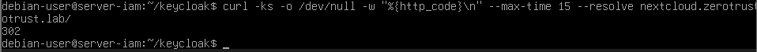

# Tests de validation

Chaque test suit le même format : **action → résultat attendu → résultat observé → interprétation**. Les sorties ci-dessous sont celles relevées dans le lab.

## 1. Segmentation et isolation

### T1 — Le port 8080 de Keycloak n'est plus joignable

Depuis Client-Debian (MGMT). Le port d'administration directe a été retiré du compose : Traefik est l'unique point d'entrée.

```console
debian-user@client-debian:~$ nc -zv -w3 10.10.2.10 8080
whoami.zerotrust.lab [10.10.2.10] 8080 (http-alt) : Connection timed out
```


**Interprétation** : `timed out` (et non `refused`) indique que le paquet est abandonné par le pare-feu, sans réponse.

### T2 — Nextcloud refuse l'accès par adresse IP (depuis IAM)

Depuis Server-IAM, requête vers Nextcloud par son IP puis avec le nom de domaine :

```console
$ curl -s -o /dev/null -w "%{http_code}\n" --max-time 15 http://10.10.3.30/
400
$ curl -s -o /dev/null -w "%{http_code}\n" --max-time 15 -H "Host: nextcloud.zerotrust.lab" http://10.10.3.30/
302
```




**Interprétation** : l'accès par IP est rejeté (`400`, domaine non fiable). **Ce test ne prouve rien à lui seul** : il est valable depuis IAM, qui est le chemin légitime. Le test T10 montre que ce n'était pas suffisant depuis le segment ATTACKER.

### T3 — Flux Traefik → Nextcloud

```console
$ nc -zv -w4 10.10.3.30 80
(UNKNOWN) [10.10.3.30] 80 (http) open
$ nc -zv -w4 10.10.3.30 443
(UNKNOWN) [10.10.3.30] 443 (https) : Connection refused
```

**Interprétation** : seul HTTP/80 est exposé par Nextcloud vers IAM ; le TLS est terminé par Traefik.

### T4 — Isolation du segment MONITORING (test négatif)

Depuis Server-Monitoring, connexions sortantes vers IAM et APPS (SSH, TCP) : **toutes expirent**. Le flux Wazuh est strictement unidirectionnel (agents → manager).

**Incident révélé par ce test** : une règle `any→any` TCP non documentée et non journalisée sur OPT5 permettait à MONITORING d'atteindre IAM/APPS en SSH. Désactivée, testée (tous les tests sortants expirent), puis supprimée.

**Leçon** : un audit visuel des règles ne remplace pas un test négatif exécuté.

## 2. Authentification

| Test | Action | Attendu | Observé |
|---|---|---|---|
| T5 Sans session | `curl -I https://whoami.zerotrust.lab` | Redirection vers Authelia | `302` vers `auth.zerotrust.lab` ; `401` visibles dans les logs Traefik côté forward-auth |
| T6 MFA | Connexion Authelia | Mot de passe puis TOTP exigés | Code à usage unique demandé après le mot de passe |
| T7 Chaîne SSO | Accès à Nextcloud après Authelia | Redirection Keycloak puis tableau de bord | Tableau de bord Nextcloud affiché (utilisateur `Test User`) |
| T8 URI de redirection | Redirect URI non enregistrée | Rejet Keycloak | `Invalid parameter: redirect_uri` |


## 3. Supervision

| Test | Attendu | Observé |
|---|---|---|
| T9 Agents Wazuh | 4 agents actifs | 001 server-iam, 002 server-nextcloud, 003 server-db, 004 kali-attacker |

## 4. Rejeu de la Phase A depuis Kali (Step 12)

### T10 — Faille trouvée au rejeu, puis corrigée : contournement d'Authelia depuis ATTACKER

**Premier scan (avant correction)** depuis Kali (10.10.5.50) :

```console
$ nmap -sV -Pn --top-ports 1000 --max-retries 1 -oN a1-scan.txt 10.10.2.10 10.10.3.30 10.10.4.20
10.10.2.10  : 80/tcp open, 443/tcp open (Traefik)
10.10.3.30  : 80/tcp open  http  Apache httpd 2.4.68 (Debian) ; 443/tcp closed
10.10.4.20  : 80/tcp closed, 443/tcp closed
```

- Nextcloud (APPS) était joignable directement sur le port 80, **sans passer par Traefik ni Authelia**.
- La DB répondait `closed` (et non `filtered`) : les paquets traversaient le pare-feu.

Impact mesuré depuis Kali :

```console
$ curl -4 -m8 -s -H "Host: nextcloud.zerotrust.lab" http://10.10.3.30/status.php
{"installed":true,"maintenance":false,"needsDbUpgrade":false,"version":"35.0.1.1","versionstring":"35.0.1", ...}
$ curl -4 -m8 -s -o /dev/null -w "%{http_code}\n" -H "Host: nextcloud.zerotrust.lab" http://10.10.3.30/index.php/login
200
```

- Fuite de la version exacte de Nextcloud, sans authentification.
- Page de connexion servie directement : la couche Authelia (MFA) était contournée depuis ce segment. Keycloak restait une seconde barrière.
- Gravité : **moyenne**.

**Cause racine** : deux règles d'OPT4, `Attacker -> Internet http` et `https`, avaient pour destination `*`. Prévues pour l'accès Internet, elles couvraient aussi tous les segments internes.

**Correction** (OPNsense, OPT4) :

1. Alias `RFC1918` (`10.0.0.0/8`, `172.16.0.0/12`, `192.168.0.0/16`).
2. Nouvelle règle, placée en premier : `OPT4 network` → `10.10.2.10`, ports 80/443 (Traefik uniquement).
3. Les deux règles « Internet » passent en destination inversée (`!RFC1918`) : Internet oui, réseaux privés non.

**Après correction** :

```console
$ curl -4 -m8 -s -o /dev/null -w "%{http_code}\n" -H "Host: nextcloud.zerotrust.lab" http://10.10.3.30/status.php
000
$ nmap -sV -Pn --top-ports 1000 --max-retries 1 -oN a1-scan-apres.txt 10.10.2.10 10.10.3.30 10.10.4.20
10.10.2.10 : 80/tcp open, 443/tcp open
10.10.3.30 : 1000 ports filtered
10.10.4.20 : 1000 ports filtered
```

Non-régression : accès Internet de Kali conservé (`HTTP/2 200` sur un site public) ; Client-Debian atteint toujours Nextcloud par Authelia puis Keycloak.

**Leçon** : un test fait depuis le chemin légitime (T2, depuis IAM) ne prouve pas l'absence de chemin illicite. Seul le rejeu depuis le segment ATTACKER l'a révélé.

**Amélioration restante (défense en profondeur)** : restreindre Apache sur Server-Nextcloud aux seules requêtes venant de Traefik (`Require ip 10.10.2.10`).

### T11 — Services internes depuis ATTACKER (après correction)

```console
$ nc -zv -w3 10.10.3.30 22   -> Connection timed out
$ nc -zv -w3 10.10.4.20 3306 -> Connection timed out
$ nc -zv -w3 10.10.1.50 22   -> Connection timed out
$ nc -zv -w3 10.10.6.10 22   -> Connection timed out
```

**Interprétation** : SSH vers APPS, base de données, poste d'administration et supervision sont tous inaccessibles depuis ATTACKER.

### T12 — Seul chemin autorisé vers Traefik, sans contenu applicatif

```console
$ curl -4 -kI https://10.10.2.10
HTTP/2 404
content-type: text/plain; charset=utf-8
```

**Interprétation** : accédé par IP, Traefik ne trouve aucune route (`404`) et ne sert aucun contenu applicatif. Les services ne sont joignables que par leur nom de domaine, derrière Authelia.

### T13 — Force brute SSH rejouée (Hydra) : échec immédiat

En Phase A (réseau plat, Step 4), la même attaque avait réussi en moins de 2 minutes contre le compte de test `nextcloud-user`. Rejouée depuis Kali contre la Phase B, après la correction du T10 :

```console
$ hydra -l nextcloud-user -P imane_fast.txt -t 4 -f ssh://10.10.3.30
Hydra v9.6 (c) 2023 by van Hauser/THC & David Maciejak
[DATA] max 4 tasks per 1 server, overall 4 tasks, 22 login tries (l:1/p:22), ~6 tries per task
[DATA] attacking ssh://10.10.3.30:22/
[ERROR] could not connect to ssh://10.10.3.30:22 - Timeout connecting to 10.10.3.30
```

**Interprétation** : Hydra échoue dès l'étape de connexion, avant même de tester le premier mot de passe de la liste. Le port SSH étant inaccessible depuis ATTACKER (T11), l'attaque ne peut pas même démarrer — contrairement à la Phase A, où le mot de passe faible était trouvé en 2 minutes.

## 5. Bilan avant / après

| Attaque | Phase A (réseau plat) | Phase B (Zero Trust) |
|---|---|---|
| Scan Nmap | Tous services visibles | Un seul point d'entrée visible (Traefik 80/443) ; le reste `filtered` (T10) |
| Force brute SSH | Succès en 2 min | Échec immédiat, connexion impossible (T11, T13) |
| Extraction de configuration | Succès | Impossible : prérequis (accès SSH) bloqué |
| Accès direct DB | Succès | Timeout sur 3306 (T11) |
| Mouvement latéral | Succès | Timeout vers MGMT, APPS, MONITORING (T11) |
| Interception HTTP | Succès | Seul chemin : Traefik/TLS, accès par IP rejeté (T12) |
